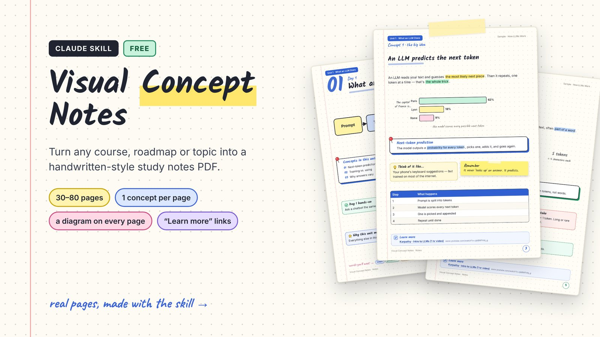

# Visual Concept Notes

Turn any course module, learning roadmap or topic into a **30–80 page handwritten-style study notes PDF**: one concept per page, a hand-drawn SVG diagram on every page, pinned key ideas, highlighter marks, sticky notes and checked "Learn more" links.



## Install

```bash
npx skills add https://github.com/himanshu231204/agent-skills --skill visual-concept-notes
```

Or copy the `visual-concept-notes/` folder into your agent's skills directory (for Claude Code: `~/.claude/skills/`).

## Use

Ask your agent:

```
Make visual concept notes for <topic / course / roadmap link>, 50–70 pages.
```

The agent gathers the material, plans the pages, writes a content file that imports `scripts/notes_engine.py`, builds the PDF, and checks every page for overflowing or sparse layouts before handing it over.

## What every PDF includes

- Dotted notebook paper, a red margin line and handwriting-style headings
- An SVG diagram on every concept page: flows, comparisons, bar charts, timelines, decision trees
- A pinned "remember this" box, plus colour-coded highlights for key terms, definitions and risks
- Analogies, "common mistake" warnings and "try it" hands-on tasks
- A cover, contents, unit dividers, recap quizzes, cheat sheets, a glossary and a resources page

## Requirements

Python 3.10+, Playwright (`pip install playwright pillow`), Chrome or Chromium, Node.js and npm (fonts install automatically on first build), and `pdftoppm` for page previews.

## Files

| File | Purpose |
|------|---------|
| `SKILL.md` | Instructions the agent follows |
| `scripts/notes_engine.py` | The PDF engine: page templates, SVG helpers, build and layout checks |
| `examples/example_content.py` | A minimal working content file |

## Example output

[Google ADK 2.x: Production AI Agents](https://himanshu231204.gumroad.com/l/google-adk-notes), a free 96-page notes PDF made with this skill.

## License

MIT
